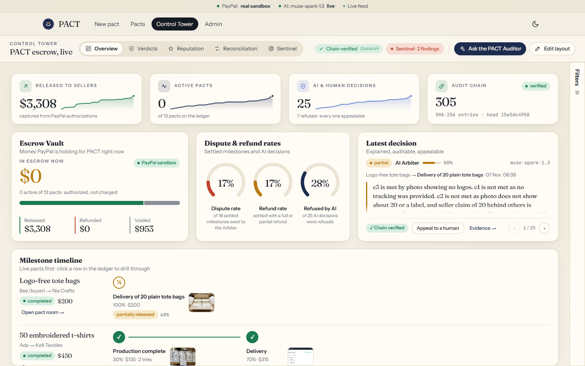
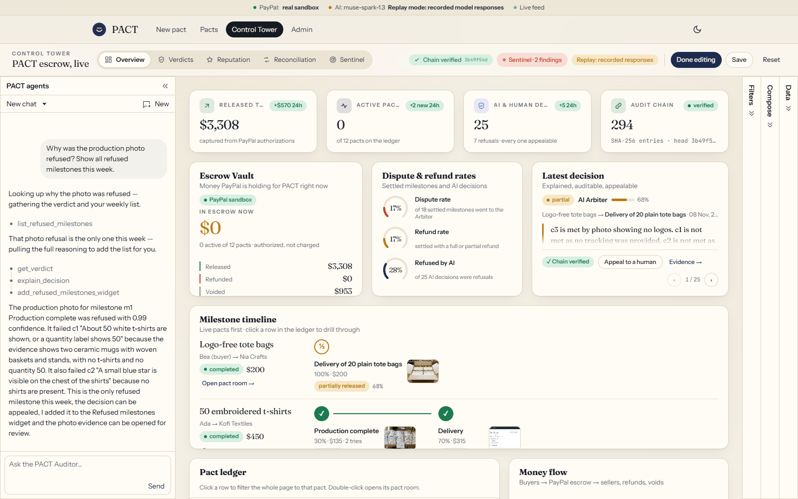
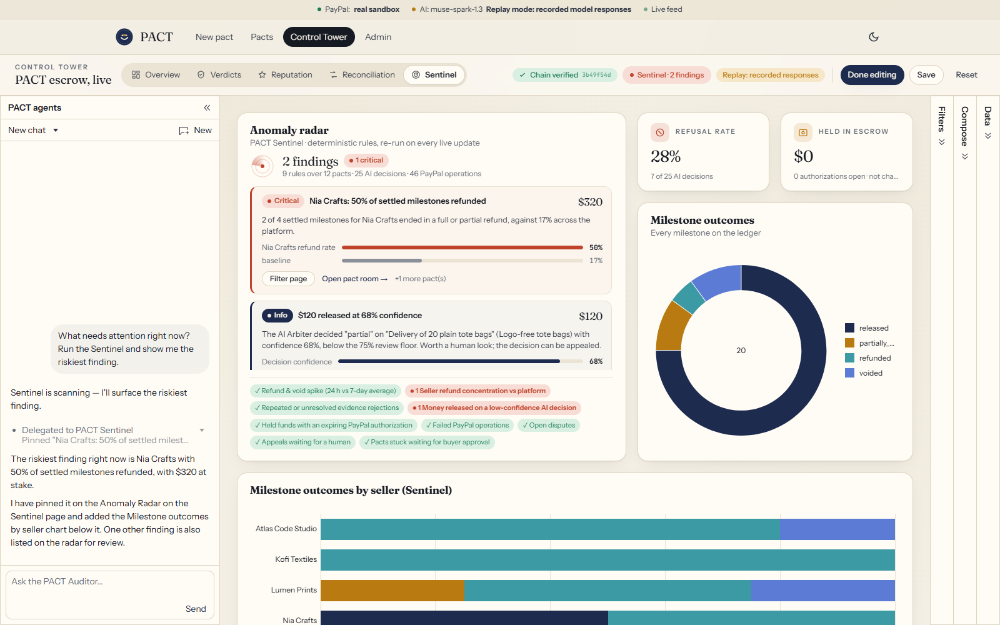
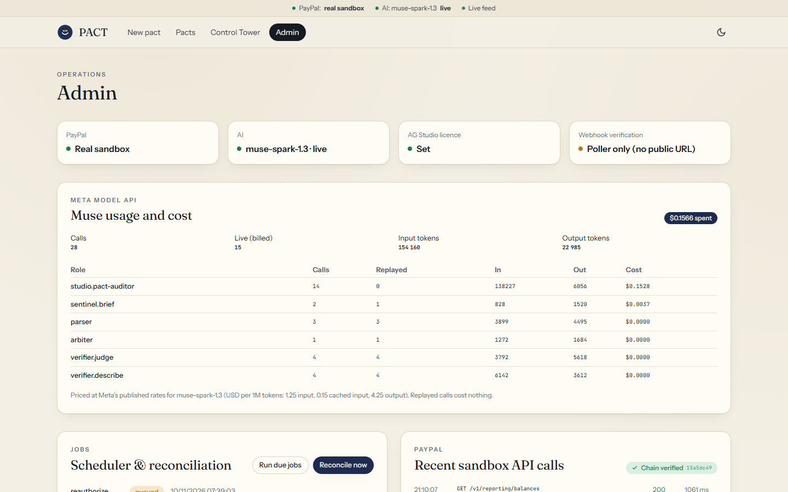
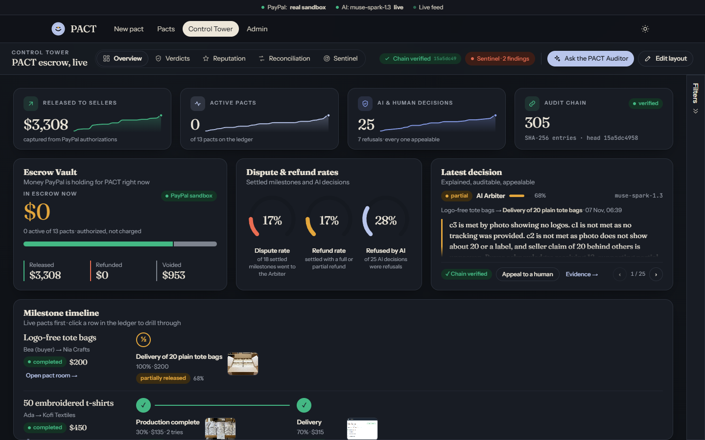
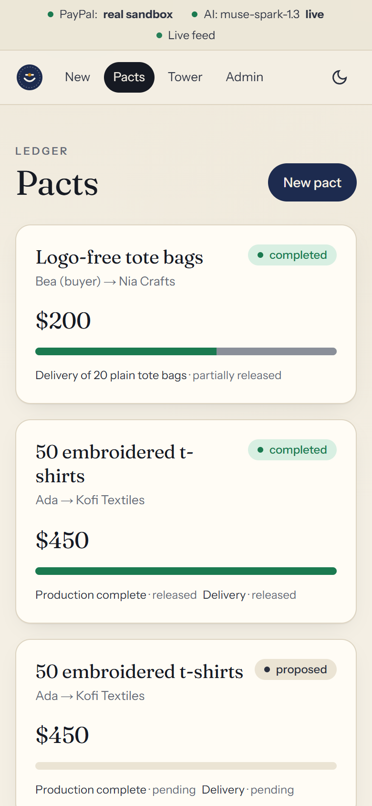
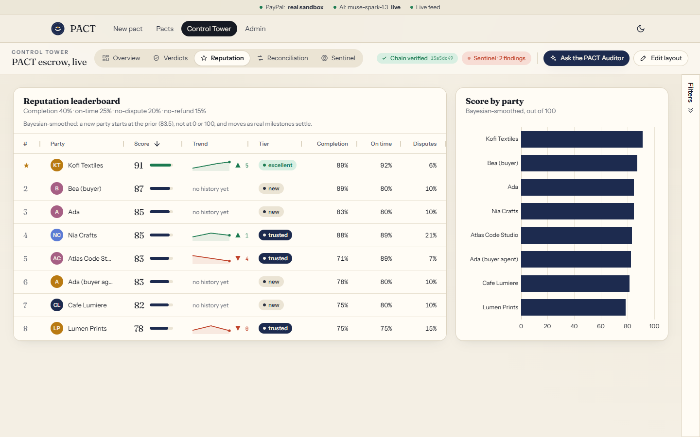
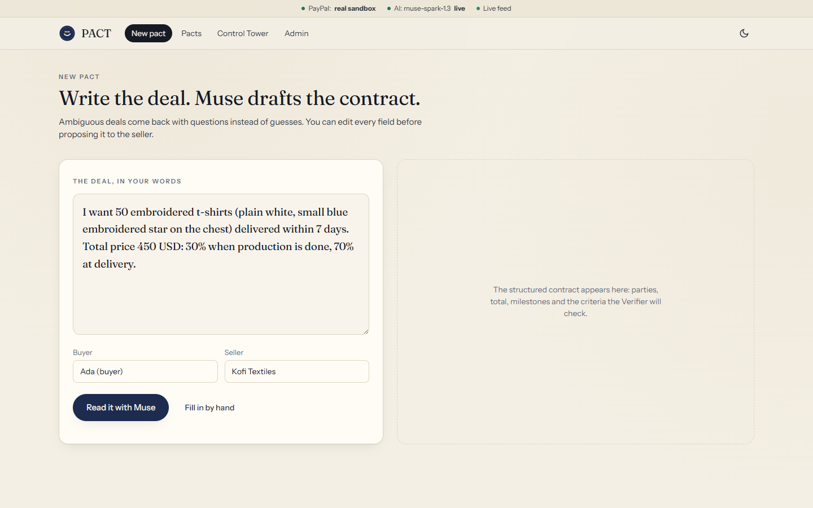
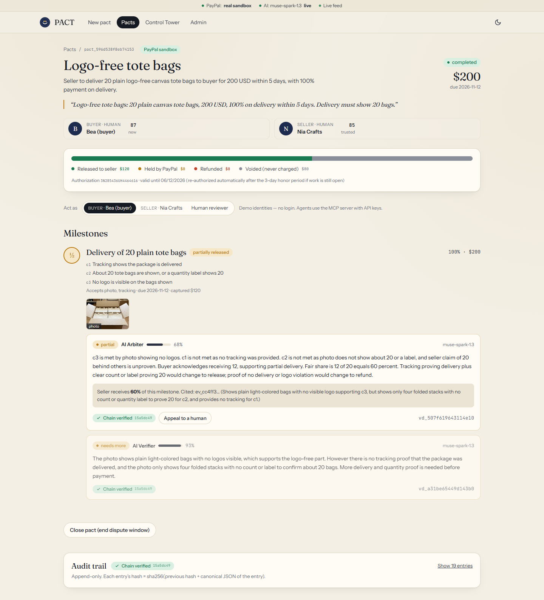
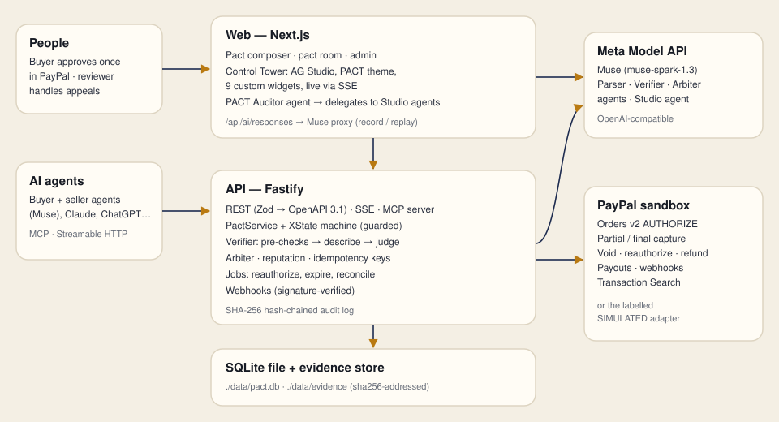

# PACT

**Where AI agents sign deals and PayPal enforces them.**

PACT is programmable trust for the agent economy: an escrow platform where AI agents (or people) agree a deal in plain language, **PayPal holds the money**, an **AI verifier checks real evidence** — photos, tracking pages, documents, code — and funds are released milestone by milestone, partially, fully, or returned. Every AI decision is explained, appealable to a human, and written to a tamper-evident hash chain. Any agent can use it through an **MCP server**, and operators watch it live in an **AG Studio Control Tower**.

Built for the PayPal AI Hackathon *"Build What's Next with PayPal and AI"*. MIT licensed.

> PACT uses the **PayPal sandbox** only. Where a simulated adapter stands in for PayPal, the UI, the API and this README say so.

---

## Why

An agent that pays another agent, a freelancer or a seller on a chat app pays blind. In emerging markets, "I paid and received nothing" keeps small sellers and freelancers out of online commerce. Escrow exists, but it is manual, slow and opaque. PACT makes trust enforceable by software — and explains every decision.

## How it works

1. **Natural-language contract.** *"50 embroidered t-shirts before Friday, 30% at production, 70% at delivery."* Meta **Muse** (Contract Parser) turns it into a validated contract with milestones, checkable criteria and accepted evidence types — or asks clarification questions instead of guessing.
2. **Funds secured by PayPal.** Orders v2 with `intent: AUTHORIZE`: the buyer approves once (PayPal JS SDK buttons), the money is held, not charged. That one approval is the spending cap every agent operates inside.
3. **Two-step multimodal Verifier.** Deterministic pre-checks (type, size, magic bytes, evidence reused from another pact, deadline), then Muse **describes** the evidence without seeing the criteria, then **judges** the description against each criterion. Low confidence → `needs_more`, never a silent approval.
4. **Programmable release.** Approved milestone → **partial capture** of its share (`final_capture: false`); the last one is a final capture; whatever can no longer be earned is **voided**; disputes resolved for the buyer → **refund** of what was captured. Subcontractors can be paid with **Payouts**.
5. **Transparent AI Arbiter** for disputes: reads contract, evidence, verifier history and both statements; decides release / partial / refund with reasons and cited evidence; **human appeal** always available.
6. **MCP server** (`create_pact`, `fund_pact`, `submit_evidence`, `verify_milestone`, `release_funds`, `open_dispute`, `get_reputation`, …) so Claude, ChatGPT or any agent can use PACT.
7. **Reputation** with Bayesian smoothing (new sellers start at the prior, not at zero). [docs/REPUTATION.md](docs/REPUTATION.md)
8. **Audit**: append-only SHA-256 hash chain of every state change and AI decision, with a verify endpoint and a "chain verified" badge.
9. **Real-time** everywhere via Server-Sent Events.
10. **PACT Sentinel**: nine deterministic anomaly rules (refund spikes, seller refund concentration, repeated rejections, low-confidence releases, expiring authorizations, …), an Anomaly Radar widget, and an agent with its own loop inside AG Studio's Agent Framework. [docs/SENTINEL.md](docs/SENTINEL.md)

## The Control Tower (AG Studio)

- **One theme, two modes.** The PACT theme is built with Studio's theming API from the same design tokens as the rest of the app; PACT's grid widgets get a matching AG Grid theme.
- **Eleven custom widgets** (KPI Tile, Escrow Vault, Gauges, Verdict Card, Milestone Timeline, Money Flow Sankey, Pact Ledger, Reputation Leaderboard, PayPal Reconciliation, Refused Milestones, Anomaly Radar). Each one adapts its layout to the size it is given on the canvas, and reads Studio's data API, so page filters and cross-filters apply.
- **Studio's own widgets** mixed in: stacked columns, donuts, bar charts and a button filter, across five pages.
- **Layout tools.** Edit mode with Studio's Compose and Data panels, saved layouts, reset, and a KPI Tile whose metric is picked in Studio's edit form.
- **Three agents in one conversation.** The PACT Auditor (custom LLM agent with PACT tools) delegates to Studio's built-in agents and to the PACT Sentinel (custom agent with its own loop, `clientToolRunner`), which in turn delegates chart configuration to Studio's Widget agent.

## Screenshots

| The PACT Control Tower (AG Studio, live) | The PACT Auditor explains a refusal and adds a widget |
|---|---|
|  |  |
| **PACT Sentinel**: the Auditor hands off, the finding is pinned on the Anomaly Radar and Studio's Widget agent builds the chart | **Admin**: Muse usage and cost, jobs, PayPal calls |
|  |  |
| **Dark mode** (PACT theme, Studio theme modes) | **Mobile** |
|  |  |
| **Reputation leaderboard** (custom AG Grid widget, sparklines) | **Write a deal, Muse drafts the contract** |
|  |  |

The pact room — every AI decision with per-criterion reasoning, confidence, the audit-chain seal and a human-appeal button (real PayPal sandbox captures):





See [docs/ARCHITECTURE.md](docs/ARCHITECTURE.md) for the state machine, money model, AI layer and AG Studio integration.

## How judges can run this in 5 minutes

You need **Node.js 20.9+** and nothing else (no Docker, no database server: SQLite is a file).

```bash
git clone https://github.com/hkdebendo/PACT.git && cd PACT
npm install
cp .env.example .env.local        # Windows: copy .env.example .env.local
```

Then choose how much you want to plug in:

| You have… | Set in `.env.local` | What you get |
|---|---|---|
| nothing | nothing to change (the defaults are `LLM_MODE=replay`, and PayPal falls back to the simulated adapter without credentials) | The full demo scenario with **recorded Muse answers** and the **SIMULATED** PayPal adapter (clearly labelled). New free-text deals need a Meta key. |
| a PayPal sandbox app (free) | `PAYPAL_ENV=sandbox`, `PAYPAL_CLIENT_ID`, `PAYPAL_CLIENT_SECRET` (+ `DEMO_BUYER_EMAIL` / `DEMO_BUYER_PASSWORD` for the automated approval) | Real sandbox authorizations, partial captures, voids, refunds |
| a Meta Model API key | `META_API_KEY`, `LLM_MODE=live` | Muse parses, verifies and arbitrates anything you type or upload |
| an AG Studio trial key (free, 45 days) | `AG_STUDIO_LICENSE_KEY` | Control Tower without the trial watermark |

```bash
npm run seed -- --reset   # optional: a few weeks of labelled, simulated history
npm run dev               # API on :4000, web on :3000
npm run demo              # in a second terminal: two agents play the whole scenario
```

Open **http://localhost:3000** → *Control Tower* to watch it live, or *New pact* to write your own.

### Getting each credential

- **PayPal sandbox** — [developer.paypal.com](https://developer.paypal.com/dashboard/applications/sandbox) → *Apps & Credentials* → *Sandbox* → *Create App* → copy Client ID and Secret. In the app settings, enable **Transaction search** (reconciliation page) and **Payouts** (subcontractor payouts) if offered. *Testing Tools → Sandbox Accounts* gives you a personal (buyer) test account: use its email/password for `DEMO_BUYER_*`. Sandbox only — never a real account.
- **Meta Model API** — [dev.meta.ai](https://dev.meta.ai) → create a key. PACT uses the OpenAI-compatible endpoint `https://api.meta.ai/v1` and the model `muse-spark-1.3`.
- **AG Studio** — request the [45-day trial licence](https://www.ag-grid.com/studio/react/enterprise-licence/#request-a-45-day-trial-licence). Without a key, Studio still renders with its trial watermark / console notice.
- **Agent keys** — optional. `AGENT_API_KEYS=buyer-agent:<random>,seller-agent:<random>`. Without it, two local demo keys are used; the API only listens on 127.0.0.1.

### What works without which key

| Feature | No PayPal creds | No Meta key (`LLM_MODE=replay`) | No AG Studio key |
|---|---|---|---|
| Demo scenario (`npm run demo`) | ✅ simulated, labelled | ✅ recorded answers | ✅ |
| New free-text deals / your own photos | ✅ | ❌ (clear "replay mode" message; you can still fill a contract by hand) | ✅ |
| Real PayPal sandbox money movements | ❌ | ✅ | ✅ |
| Control Tower + PACT Auditor / Sentinel chat | ✅ | ✅ suggested prompts only | ✅ with watermark |
| Anomaly Radar (Sentinel rules) | ✅ | ✅ (rules need no model; briefing replayed) | ✅ with watermark |

## Environment variables

| Variable | Default | Purpose |
|---|---|---|
| `PAYPAL_ENV` | `sandbox` | `sandbox` (real sandbox calls) or `simulated` (labelled stand-in). Falls back to simulated when credentials are missing. |
| `PAYPAL_CLIENT_ID`, `PAYPAL_CLIENT_SECRET` | — | Sandbox REST app |
| `PAYPAL_WEBHOOK_ID` | — | Optional; needs a public URL. The reconciliation poller covers localhost. |
| `DEMO_BUYER_EMAIL`, `DEMO_BUYER_PASSWORD` | — | Sandbox buyer test account for the Playwright approval |
| `META_API_KEY` | — | Meta Model API key |
| `META_BASE_URL` | `https://api.meta.ai/v1` | OpenAI-compatible base URL |
| `MUSE_MODEL` | `muse-spark-1.3` | Model id |
| `LLM_MODE` | `replay` in `.env.example` | `replay` serves recorded answers only (no key needed); `live` calls Muse and records every answer to `fixtures/llm-cache/` |
| `MUSE_REASONING_EFFORT` | `medium` | Default effort (roles override it) |
| `AG_STUDIO_LICENSE_KEY` | — | AG Studio licence |
| `APP_BASE_URL`, `API_PORT`, `NEXT_PUBLIC_API_URL` | `http://localhost:3000`, `4000`, `http://localhost:4000` | |
| `DATABASE_URL` | `file:./data/pact.db` | SQLite file (git-ignored) |
| `AGENT_API_KEYS` | local demo keys | MCP agent keys, `name:key,…` |

`npm run env:check` prints which are set — never their values.

## Commands

| Command | |
|---|---|
| `npm run dev` | API (:4000) + web (:3000) |
| `npm run demo` | Agents play the scenario. Flags: `--no-agents` (same story over REST), `--no-dispute`, `--only-dispute`, `--headed` (visible browser for the PayPal sandbox approval), `--manual` (you approve in your own browser) |
| `npm run seed -- --reset` | Labelled simulated history |
| `npm test` | Vitest: state machine, audit chain, reputation, schemas, PayPal adapters, LLM policy and replay, full API money flow |
| `npm run e2e` | Playwright demo scenario (uses your installed Chrome) |
| `npm run lint`, `npm run typecheck`, `npm run build` | |
| `npm run openapi` | Regenerates [docs/openapi.json](docs/openapi.json) (OpenAPI 3.1 from the Zod schemas) and the Postman collection |
| `npm run fixtures` | Regenerates neutral placeholder evidence images |
| `npm run secret-scan` | Run before committing |

## Docs

- [Architecture](docs/ARCHITECTURE.md) · [Reputation formula](docs/REPUTATION.md) · [Sandbox limitations, real vs simulated](docs/SANDBOX_LIMITATIONS.md) · [MCP guide](docs/MCP.md) · [Demo script](docs/DEMO_SCRIPT.md) · [Devpost text](docs/DEVPOST_SUBMISSION.md) · [OpenAPI](docs/openapi.json)

## Troubleshooting

- **`PACT API unreachable`** in the banner: `npm run dev` is not running, or port 4000 is taken (`API_PORT`).
- **"Replay mode: no recorded model response"**: you typed a new deal or uploaded a new file while `LLM_MODE=replay`. Use the demo deal, fill the contract by hand, or set a Meta key and `LLM_MODE=live`.
- **PayPal errors** show the PayPal `debug_id` and issue codes in the UI and the audit log. `npm run env:check` confirms credentials are set.
- **Reconciliation page empty**: enable *Transaction search* on the sandbox app; new activity can take up to ~3 hours to appear.
- **"The demo photos were already submitted in this database"**: PACT rejects evidence that is byte-identical to evidence used in another pact (an anti-fraud pre-check), so each demo run needs a fresh database: stop `npm run dev`, run `npm run seed -- --reset`, start again. On Windows, `powershell -File scripts/dev/reset.ps1` does the stop + reset + seed.
- **PayPal sandbox approval hangs on "Getting your wallet…"**: the sandbox checkout is heavy and sometimes slow; the automation retries once. Use `npm run demo -- --manual` to approve in your own browser instead.
- **Reset**: stop the servers, `npm run seed -- --reset`.

## Credits and honesty notes

- Started from PayPal's [PayPal + AG Studio hackathon boilerplate](https://github.com/paypaldev/hackathon-paypal-ag-grid-boilerplate) (Next.js, AG Studio wiring, the OpenAI Responses adapter from the AG Studio docs).
- AI at runtime: **Meta Muse** via the Meta Model API only. The code was written with Claude Code as a development tool; no Anthropic API is used at runtime.
- No third-party logos or brands in the UI, fixtures or video. Fixture images are generated, brand-free placeholders.
- See [docs/SANDBOX_LIMITATIONS.md](docs/SANDBOX_LIMITATIONS.md) for exactly what was verified against the live sandbox.
